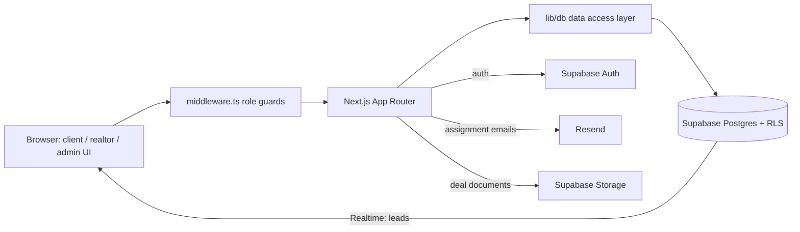
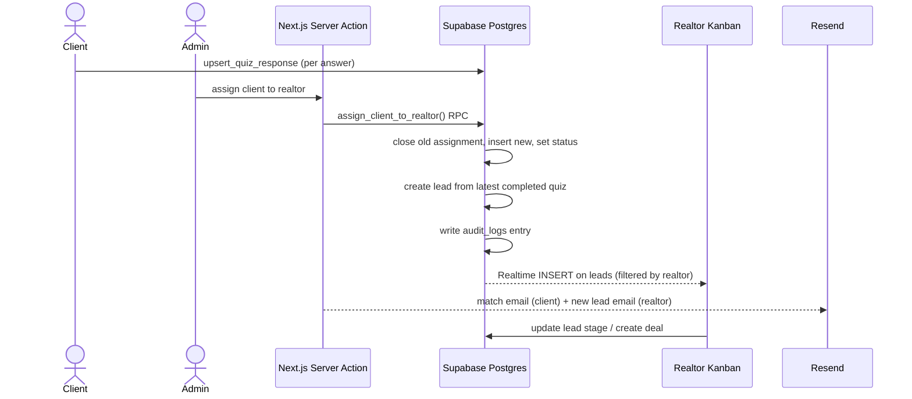

<div align="center">

# Align

**A real estate agent-matching platform that scores the quiz, routes each client to the right realtor, and drops the lead into that realtor's pipeline in real time.**

-yellow)

</div>

<!-- TODO: record a short demo (quiz -> admin assigns -> lead appears on realtor Kanban) and save it as docs/demo.gif. Delete this image line if you skip it. -->


**Tech:** TypeScript · Next.js 15 · React 19 · Supabase (Postgres, Auth, Realtime, RLS) · Tailwind · Resend · Vercel

---

## Overview

Most real estate platforms are built around listings, but for a lot of buyers and sellers the harder problem is finding the right agent. Referrals are random, and agents get leads with no context on what the client actually wants.

Align fixes the matching side. Clients take a 9 section quiz, an admin reviews the answers and assigns the client to a realtor, and the realtor receives a lead that is already filled in from the quiz. Clients use it for free, and Align's model is a referral fee on deals that close. I built the full stack: the quiz, the admin panel, and the realtor CRM.

## Features

**One quiz replaces the intake call.** Clients answer 40 questions across 9 sections covering intent, budget, location, timeline, and what they want from an agent. Questions and whole sections show or hide based on earlier answers, and progress saves as they go, so they can leave and resume exactly where they stopped.

**Admins assign with a full audit trail.** KPI dashboard, client and realtor management, quiz answer viewer with CSV export, and assign, reassign, and unassign actions that each write an audit entry.

**Realtors get leads that are already qualified.** An assigned client appears on the realtor's Kanban board without a refresh, pre-filled with purchase intent and budget from the quiz. From there they move it through New, Working, Nurture, and Client or Lost, set follow-up dates, decline with a reason, and convert it into a CRM client.

**The realtor side is a small CRM.** Onboarding with a digital MSA signature, appointments, a deals pipeline with document attachments, referral contracts, and payouts.

**Three roles, enforced in the database.** Clients, realtors, and admins each see only their own data. The UI redirects are a convenience, and Postgres is what actually rejects an unauthorized query.

## Tech Stack

| Layer | Technology | Notes |
| ----- | ---------- | ----- |
| App framework | [Next.js 15](https://nextjs.org/) (App Router) | Server Components by default; Server Actions and Route Handlers for mutations. |
| UI | [React 19](https://react.dev/) + [Tailwind CSS 3](https://tailwindcss.com/) + [shadcn/ui](https://ui.shadcn.com/) | Radix primitives, Framer Motion for animation, Lucide icons. |
| Language | [TypeScript](https://www.typescriptlang.org/) | Typed data access modules under `lib/db`. |
| Database / auth | [Supabase](https://supabase.com/) (Postgres, Auth, Realtime, Storage) | RLS on every table, SECURITY DEFINER RPCs, cookie sessions via `@supabase/ssr`, email + OTP signup. |
| Forms | [React Hook Form](https://react-hook-form.com/) + [Zod](https://zod.dev/) | Quiz and CRM forms. |
| Drag-and-drop | [@dnd-kit](https://dndkit.com/) | Realtor leads Kanban board. |
| Email | [Resend](https://resend.com/) | Match and new-lead notifications on assignment. |
| Hosting | [Vercel](https://vercel.com/) + [Supabase Cloud](https://supabase.com/) | Auto-deploy from `main`. |

## Screenshots

**Landing page:** public entry point for clients


**Matching quiz:** one section at a time, auto-saved


**Realtor dashboard:** leads Kanban with realtime delivery


**Admin dashboard:** KPIs, work queues, and assignments


## Architecture



All queries go through one typed data access layer, and the database, not the app, is the authorization boundary. Realtime closes the loop by pushing new leads from Postgres straight to the realtor's browser.

## Engineering Decisions

**Putting authorization in the database, not the middleware.** Three roles share one app and one set of tables, so a bug in a route guard could expose another user's data. `middleware.ts` and the layout checks only redirect people to the right place. The real rules are RLS policies: admins pass `is_admin()`, realtors are limited to rows where `realtor_id = auth.uid()`, and clients to rows where `user_id = auth.uid()`. Admin mutations go through `SECURITY DEFINER` functions that call `require_admin()` first, so the service role key never reaches the browser or a request handler.

**Making assignment one transaction that also creates the lead.** The first version of `assign_client_to_realtor` only wrote the assignment, so a realtor was assigned a client and saw an empty dashboard. The dashboard reads `leads` by `assigned_realtor_id`, which is the realtor's auth user id and not the `realtors.id` the assignment used. The `assignment-lead-sync.sql` migration fixed this by having the function do everything atomically: close any active assignment, insert the new one, update the client status, look up the realtor's user id, and create a `leads` row seeded from the client's latest completed quiz (purpose, budget, area). The audit entry is written in the same call, so an assignment can't exist without its lead or its log.

**Keeping `clients` and `crm_clients` separate on purpose.** `clients` is the admin's record of the person who took the quiz and their assignment history. `crm_clients` is the realtor's own working record, created only when they convert a lead. If they were one table, an admin reassigning a client would collide with whatever the realtor had already written about them. Keeping them apart means admin workflows never touch the realtor's CRM data.

**Storing the quiz as data instead of code.** Sections, questions, options, and visibility rules live in the `quiz_*` tables, loaded by an idempotent `npm run seed:quiz`, so changing a question is a data update and not a deploy. Conditional logic is a small rule format (`all` / `any` conditions with operators like `eq`, `neq`, and `in`) evaluated by `isVisible()` in `lib/quiz/visibility.ts`. Each answer is saved through the `upsert_quiz_response` RPC, with text inputs debounced by 400ms, which is why a client can close the tab and resume mid-quiz.

## What's Next

- Replace manual assignment with a matching score. Quiz answers are already stored as structured responses per question key, so scoring realtors against them is a function over existing data rather than a schema change.
- Add assignment rules (round-robin and capacity-based). Realtor capacity and an active toggle already exist in the admin panel and aren't used for routing yet.
- Add an automated test suite. Coverage today is a manual QA guide in `docs/TESTING.md`.
- Wire up Stripe for payouts. Payout records exist, but money movement is not implemented.

<details>
<summary><b>Technical deep dive</b></summary>

**Core mechanic:** A client's quiz answers are stored per question; an admin calls one Postgres function to assign them; that function creates a pre-filled lead, and Supabase Realtime delivers it to the realtor's Kanban board.

### Assignment sequence



### Architecture notes

- **Two mutation patterns, chosen by who triggers them.** Admin and quiz mutations are Server Actions, which lets them call `revalidatePath()` after writing. Realtor mutations are REST handlers under `app/api/realtor/`, because they fire from interactive client components (Kanban drag, modals) where a `fetch` is the natural call.
- **A single data access layer.** Every Supabase query lives in `lib/db/*` (one module per domain: leads, deals, appointments, payouts, and so on), so components never build queries themselves.
- **Server Components first.** Client components are limited to what needs the browser: the Kanban board, modals, controlled forms, and the Realtime subscription.
- **Realtime is scoped per realtor.** The Kanban subscribes to `postgres_changes` on `leads` with an `assigned_realtor_id` filter and handles INSERT, UPDATE, and DELETE into local state.
- **Roles sync from `profiles`.** Triggers in `sync-profiles-triggers.sql` create the matching `clients` or `realtors` row when a profile is created or its role changes, and `handle_new_user()` gives every new account the `client` role.
- **Email never blocks a mutation.** Notifications from `lib/email.ts` fire after the assignment succeeds, so a Resend failure can't roll back or fail an assignment.

### Route map

| Area | Routes |
| ---- | ------ |
| Public | `/`, `/signup`, `/login`, `/verify-otp`, `/forgot-password`, `/reset-password` |
| Client | `/quiz`, `/quiz/[sectionKey]`, `/quiz/complete`, `/dashboard` |
| Admin | `/admin`, `/admin/clients`, `/admin/realtors`, `/admin/assignments`, `/admin/quizzes`, `/admin/audit`, `/admin/settings` |
| Realtor | `/realtor`, `/realtor/onboarding`, `/realtor/leads`, `/realtor/appointments`, `/realtor/clients`, `/realtor/deals`, `/realtor/referrals`, `/realtor/payouts`, `/realtor/settings` |
| Realtor API | `/api/realtor/leads/*`, `/api/realtor/appointments/create`, `/api/realtor/deals/create`, `/api/realtor/clients/create`, `/api/realtor/profile/*`, `/api/realtor/sign-msa` |

### Project structure

```text
Align/
├── app/
│   ├── admin/             # Admin pages and server actions
│   ├── realtor/           # Realtor CRM: leads, deals, appointments, onboarding
│   ├── quiz/              # Quiz pages, components, server actions
│   ├── api/               # Route handlers: realtor mutations, quiz structure, signout
│   ├── login/ signup/ verify-otp/ forgot-password/ reset-password/
│   └── dashboard/         # Client dashboard / role redirect
├── components/ui/         # shadcn/ui primitives
├── lib/
│   ├── db/                # Data access layer, one module per domain
│   ├── quiz/              # Types, conditional visibility logic
│   ├── email/             # Email templates
│   └── supabaseClient.ts / supabaseServer.ts
├── migrations/            # Admin panel, profile sync triggers, assignment-lead sync
├── seed/                  # Quiz definition JSON + quiz.sql
├── scripts/               # seed-quiz.ts
├── docs/                  # API.md, ARCHITECTURE.md, TESTING.md, screenshots
├── SETUP.sql              # profiles table + signup trigger
├── DATABASE.md            # Full schema reference
└── middleware.ts          # Role-based route protection
```

Extended docs live in `docs/API.md`, `docs/ARCHITECTURE.md`, `docs/TESTING.md`, and `DATABASE.md`.

### Security

| Mechanism | Where |
| --------- | ----- |
| Row Level Security on all tables | `SETUP.sql`, `migrations/admin-panel.sql`, `seed/quiz.sql` |
| Role helpers for policies | `is_admin()`, `is_realtor()`, `is_client()` in `admin-panel.sql` |
| Admin-only mutations | `SECURITY DEFINER` RPCs that call `require_admin()` first |
| Route guard by role | `middleware.ts`, with a second check in `app/admin/layout.tsx` and `app/realtor/layout.tsx` |
| HTTP-only cookie sessions | `@supabase/ssr`, no tokens in localStorage |
| New accounts default to least privilege | `handle_new_user()` assigns `client`; admin and realtor roles are granted manually in SQL |
| Service role key kept out of the app runtime | Used only by `scripts/seed-quiz.ts` |
| Explicit session checks on sensitive handlers | `sign-msa` and `convert-to-client` |

Several other realtor routes (`update-stage`, `decline`, `set-next-touch`) skip an in-handler session check and rely on RLS to reject unauthorized writes.

</details>

<details>
<summary><b>Run it locally</b></summary>

### Prerequisites

- Node.js 20+
- A [Supabase](https://supabase.com/) project (free tier works)
- (Optional) A [Resend](https://resend.com/) account, only needed for assignment emails

### Setup

```bash
git clone https://github.com/ar1shah/Align.git
cd Align
cp .env.local.example .env.local   # fill in Supabase keys (names below)
npm install
```

In the Supabase SQL Editor, run these files in order:

```text
1. SETUP.sql
2. seed/quiz.sql
3. migrations/admin-panel.sql
4. migrations/sync-profiles-triggers.sql
5. migrations/assignment-lead-sync.sql
```

Then seed the quiz and start the app:

```bash
npm run seed:quiz
npm run dev
```

Sign up through `/signup`, then promote your account (new accounts are clients by default):

```sql
UPDATE profiles SET role = 'admin' WHERE email = 'you@example.com';
-- or 'realtor' to try the realtor side (finish onboarding at /realtor/onboarding)
```

See `DATABASE.md` for the full migration reference.

### Required env var names

- `NEXT_PUBLIC_SUPABASE_URL`
- `NEXT_PUBLIC_SUPABASE_ANON_KEY`
- `SUPABASE_SERVICE_ROLE_KEY` (used only by `npm run seed:quiz`)
- `RESEND_API_KEY` (optional)
- `NEXT_PUBLIC_APP_URL` (optional; defaults to `http://localhost:3000`)

### Useful scripts

| Script | Command |
| ------ | ------- |
| `npm run dev` | Start the dev server |
| `npm run build` / `npm run start` | Production build and serve |
| `npm run lint` | ESLint |
| `npm run seed:quiz` | Seed or update quiz sections, questions, and options |

</details>

---

Align was built as an MVP for a real estate agent-matching business. Production is paused, so there is no public live link, and the screenshots above are the best look at it. This repo is public for portfolio context.

Ari Shah · [Portfolio](https://www.ar13.dev/) · [LinkedIn](https://linkedin.com/in/arishah)

MIT License, see [LICENSE](LICENSE).
